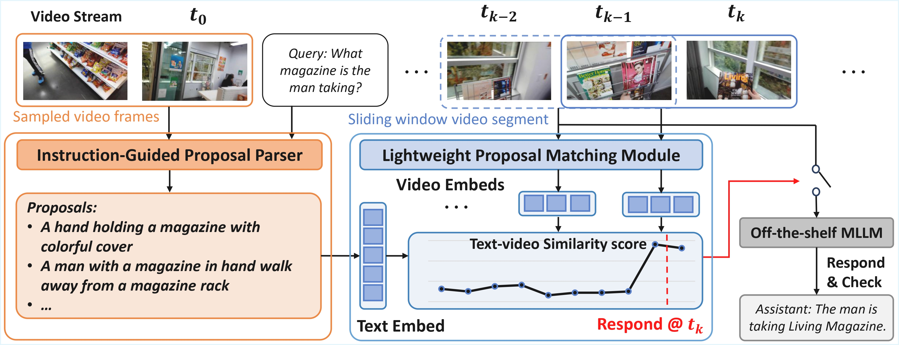

## [ECCV 2026] The Implementation of *Em-Garde: A proposal-match framework for proactive streaming video understanding*

[](https://arxiv.org/abs/2603.19054)
[](https://huggingface.co/fredzheng/Em-Garde-7B)



## Installation
Basic environment:

```
conda create -n em_garde python==3.10
conda activate em_garde
pip install -r requirements.txt
```

This project requires `ffmpeg` for video processing. Install it via your system package manager:

```
# Ubuntu/Debian
sudo apt install ffmpeg

# macOS
brew install ffmpeg

# Conda
conda install -c conda-forge ffmpeg
```

## Usage

run demo:

```
python -m demo --yaml-path=configs/demo/demo_solution
```

The video and query can be customized in `configs/demo`. Refer to `configs/demo/demo_solution.yaml`. The triggering results will be stored under `demo/`.

run proactive evaluation:

prepare [StreamingBench](https://github.com/THUNLP-MT/StreamingBench), [OVO-Bench](https://github.com/JoeLeelyf/OVO-Bench) and [ProactiveVideoQA](https://github.com/yellow-binary-tree/ProactiveVideoQA) data according to official repo. Note that we use `src_videos` instead of `chunked_videos` for OVO-Bench.


StreamingBench Evaluation:

```
python -m eval.streamingbench.streamingbench_eval_online --data-path=/path/to/StreamingBench/src/data/questions_proactive.json
```

OVO-Bench Evaluation:

```
python -m eval.ovo_bench.ovo_bench_eval_online --data-path=/path/to/OVO-Bench/data/ovo_bench_new.json --video-root=/path/to/OVO-Bench/data/src_videos
```

ProactiveVideoQA Evaluation (EGO):

```
python -m eval.proactive_video_qa.eval_proactive_video_qa --data-path=/path/to/proactive_video_qa/EGO/anno.json
```

Please follow [ProactiveVideoQA](https://github.com/yellow-binary-tree/ProactiveVideoQA) to compute the PAUC metric after obtaining the results.

## Training data

Annotations and processing scripts for SFT and RL are included. Source videos are not redistributed. Obtain COIN, Ego4D, and Behavior videos from their official sources and arrange them as `$DATA_ROOT/COIN`, `$DATA_ROOT/Ego4D`, and `$DATA_ROOT/Behavior`. Annotation files may contain machine-specific absolute paths and should be rewritten to local paths.

SFT annotations are in `train/sft/llm_data_generation/data/`. The conversion helper is `train/sft/data/convert_to_qwen.py` and creates 15-second, 1 FPS history clips.

RL input is `train/rl/data/filtered_2.json`. Run `train/rl/data/data_process.py` from the repository root with its `--input-json`, `--output-parquet`, `--output-jsonl`, and `--video-root` arguments. It creates 10-second history clips at 1 FPS and target clips at 5 FPS. Keep generated videos and Parquet files outside Git; publish manifests and checksums with any separate data release.

The complete currently available SFT and RL bundle is hosted at [fredzheng/em_garde_data](https://huggingface.co/datasets/fredzheng/em_garde_data). The repository also contains the same bundle under `data_bundle/` when the data release is checked out locally. The bundle is approximately 2.3 GB and contains processed clips; source COIN, Ego4D, and Behavior videos are not redistributed.

```text
data_bundle/
├── README.md
├── sft/
│   ├── sft_data_qwen.jsonl
│   └── videos/*.mp4
└── rl/
    ├── rl_format2.parquet
    ├── filtered_2.json
    └── videos/<sample_id>/{query_*.mp4,tgt_*.mp4}
```

### SFT format

`data_bundle/sft/sft_data_qwen.jsonl` is JSON Lines. Each non-empty line is one JSON object:

```json
{
  "video": "videos/example_0.mp4",
  "conversations": [
    {"from": "human", "value": "<video>\n... Query: ..."},
    {"from": "gpt", "value": "[{\"positive\": \"...\"}, {\"negative\": \"...\"}]"}
  ]
}
```

The `video` path is relative to `data_bundle/sft/`. The human message must contain the `<video>` placeholder and the visual-clue instruction. The GPT value is a JSON-encoded list of clue objects; each object has either a `positive` or `negative` string. Use this file directly with the Qwen-VL fine-tuning data loader. Do not rename clips without updating every `video` field.

The source SFT annotations are in `train/sft/llm_data_generation/data/`:
`data_behavior.jsonl`, `data_coin.json`, and `data_ego4d.jsonl`.

### RL format

`data_bundle/rl/rl_format2.parquet` is the production annotation consumed by the Em-Garde VERL data-preparation script. Its logical records contain:

- `problem`: prompt text containing `<video>` and the clue-output format.
- `answer`: the reference answer/proposals.
- `query_video`: an object containing a query/history video path.
- `target_videos`: an object or list containing target video path(s).
- `positive_timestamps`: timestamps for relevant target frames.
- `events`: optional event metadata with `timestamp_indices`.

Processed RL videos are stored under `data_bundle/rl/videos/<sample_id>/`. Keep sample IDs, directory names, and `query_*.mp4`/`tgt_*.mp4` filenames unchanged. 

`data_bundle/rl/filtered_2.json` is the source annotation used to regenerate clips. Its `video_path` values use `${DATA_ROOT}/COIN`, `${DATA_ROOT}/Ego4D`, and `${DATA_ROOT}/Behavior` placeholders. To regenerate clips, obtain the official source datasets, preserve their expected filenames/layouts, and run `train/rl/data/data_process.py`.

### Path and redistribution rules

- Treat all paths in annotations as portable paths or placeholders; never depend on `/data/zhengyikai/...` or another machine-specific prefix.
- Mount the bundle at a stable root and resolve SFT paths from `sft/` and RL paths from `rl/`.
- Keep generated videos and Parquet files out of Git history; use the Hugging Face dataset for large artifacts.
- Source videos are governed by the licenses and access terms of COIN, Ego4D, and Behavior. Do not redistribute source videos unless their terms allow it.
- Record the dataset revision and any path-rewriting or train/test split seed used for an experiment.

## Acknowledgements

This codebase includes adapted code from the following public projects:

- `vlm2vec/` is based on [VLM2Vec](https://github.com/TIGER-AI-Lab/VLM2Vec).
- `embedding_models/ops_mm_embedding_v1.py` is adapted from [Ops-MM-Embedding](https://huggingface.co/OpenSearch-AI/Ops-MM-embedding-v1-2B).

We thank the original authors for making their code publicly available.

## Cite

If you find our project useful, please cite:

```bibtex
@misc{zheng2026emgarde,
title={Em-Garde: A Propose-Match Framework for Proactive Streaming Video Understanding}, 
author={Yikai Zheng and Xin Ding and Yifan Yang and Shiqi Jiang and Hao Wu and Qianxi Zhang and Weijun Wang and Ting Cao and Yunxin Liu},
year={2026},
eprint={2603.19054},
archivePrefix={arXiv},
primaryClass={cs.CV},
url={https://arxiv.org/abs/2603.19054}, 
}